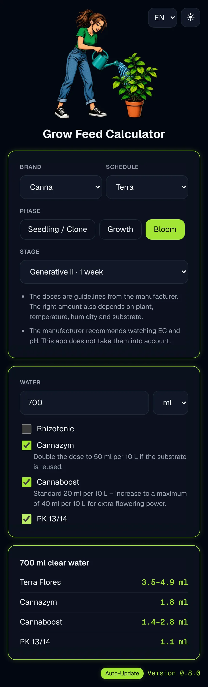
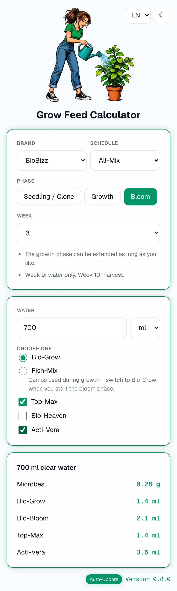
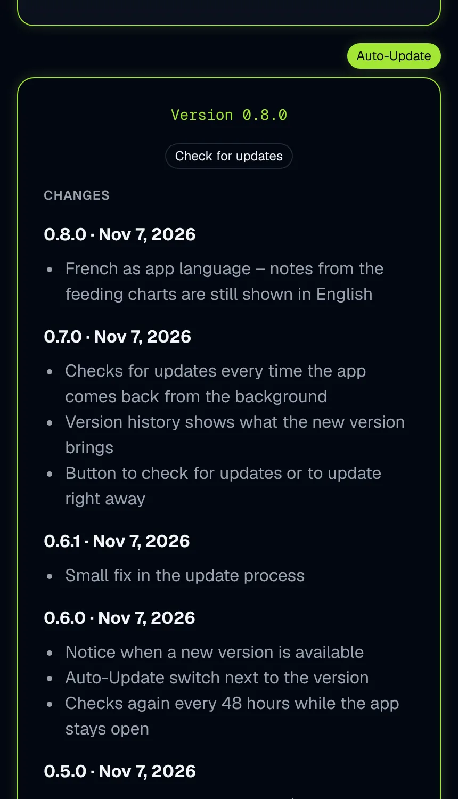

**English** | [Deutsch](/docs/README.de.md)

<div align="center">


# 🌱 Grow Feed Calculator

**A small, open calculator for fertilizer amounts – right on your phone.**<br>
Pick a phase and a week, enter how much water you mix, and get the exact amount of every product.


### 👉 [Open the app](https://gerry-git-ops.github.io/grow-feed-calculator/)

</div>

---

> [!NOTE]
> **Early version.** The calculator works and can be installed on your home screen,
> but so far only with the Hesi soil feeding chart.

The app only **calculates**. It does not track or monitor your plants – that is the job of a future
**Grow Manager**, which will be able to use this calculator through an API.

## 📸 Screenshots

<div align="center">





</div>

> [!TIP]
> The screenshots are **example images** that show the whole page at once. On your phone you scroll
> through it, and depending on device and browser the app can look slightly different.
>
> **Development and test environment:** iPhone 16 Pro Max with iOS 26.6.2.

## ✨ Features

- 🧮 Exact amounts for any amount of water, scaled from the manufacturer's feeding chart
- 💧 Water in **ml or L**, with comma or dot (`700`, `0,7` or `0.7`)
- 🧴 Products with their own units, e.g. ml per 10 L or drops per 4.5 L
- ☑️ **Optional products** (like PowerZyme) only when you switch them on, with short usage notes
- 🫗 **Premix products** (like SuperVit) are shown with the water instead of as a dose –
  tiny amounts like 0.16 drops cannot be measured, so you mix them into your watering water beforehand
- 🌍 **English and German**, chosen automatically from your device, switchable at any time
- 🌗 **Light and dark mode**, follows your device until you switch it yourself
- 📲 **Installable** on your home screen and works **offline**
- 🏷️ Version and change history right in the app

## 📲 Install

<details>
<summary><b>iPhone / iPad (Safari)</b></summary>

1. Open the [app](https://gerry-git-ops.github.io/grow-feed-calculator/) in Safari.
2. Tap the share button (square with arrow).
3. Choose **Add to Home Screen**.

</details>

<details>
<summary><b>Android (Chrome)</b></summary>

1. Open the [app](https://gerry-git-ops.github.io/grow-feed-calculator/) in Chrome.
2. Tap the menu (⋮).
3. Choose **Add to Home screen** or **Install app**.

</details>

## 🔄 Updates and offline use

- **Online:** every time you open the app, it briefly checks whether there is a newer version.
  Only changed files are downloaded – if nothing changed, nothing is loaded.
- **Offline:** the app uses the copy stored on your device and works as usual.
- **What is stored on your device:** the app files (about 0.8 MB) and your settings for language and
  light/dark mode. Your inputs are **not** saved, and nothing is sent to a server.

The installed version is shown at the bottom of the app – tap it to see what changed.

> [!NOTE]
> Planned: a switch to turn automatic updates off. You will then see a notice when a new version
> is available and can decide yourself when to update.

## 🏷️ Changelog

<details>
<summary><b>0.4.0</b> · 2026-11-07</summary>

- New logo and app icon
- Install the app on your home screen
- Works offline

</details>

<details>
<summary><b>0.3.0</b> · 2026-11-07</summary>

- Light and dark mode
- English and German
- Switches for language and theme

</details>

<details>
<summary><b>0.2.0</b> · 2026-11-07</summary>

- First calculator page
- Water in ml or L, with comma or dot
- Optional and premixed products

</details>

<details>
<summary><b>0.1.0</b> · 2026-11-06</summary>

- Hesi soil feeding chart
- Dose calculation

</details>

The same history is shown in the app. It is kept in [`changelog.json`](changelog.json).

## 🧪 Included feeding charts

| Brand | Schedule | Weeks |
|---|---|---|
| Hesi | Soil | Seedling/clone, 2 × growth, 8 × bloom (week 8: flush with plain water) |

## ⚙️ How it works

Every dose in a feeding chart refers to an amount of water, its *base volume*:

```
amount = dose × water ÷ base volume
```

Example: Bloom Complex is 50 ml per 10 L. For 700 ml of water that is 50 × 0.7 ÷ 10 = **3.5 ml**.

<details>
<summary><b>Data format</b> – for adding your own feeding charts</summary>

Each brand has one file in `data/<brand>.json`:

```json
{
  "schemaVersion": 1,
  "brand": { "id": "hesi", "name": "Hesi" },
  "schedules": [
    {
      "id": "soil",
      "medium": "soil",
      "products": [
        { "id": "bloom-complex", "name": { "en": "Bloom Complex", "de": "Blüh Complex" },
          "unit": "ml", "baseVolumeLiters": 10 }
      ],
      "weeks": [
        { "phase": "bloom", "week": 1, "doses": { "bloom-complex": 50 } }
      ]
    }
  ]
}
```

| Field | Meaning |
|---|---|
| `id` | Fixed technical name, used by the code and later by the API |
| `name` | Product name per language, `en` is required |
| `unit` | `ml` or `drops` |
| `baseVolumeLiters` | Amount of water the dose refers to |
| `optional` | `true` if the user switches the product on per feeding |
| `premix` | `true` if the product is mixed into the water beforehand (shown with the water, not as a dose) |
| `note` | Optional short usage hint per language, shown below the product's switch |
| `phase` | `start` (seedling or clone), `growth` or `bloom` – the shown words come from the app's language files |
| `doses` | Product ID → dose. A missing product is not given that week, an empty list means plain water |

</details>

<details>
<summary><b>Run it locally</b></summary>

Serve the folder with any local web server – the browser does not load the data files when you open
`index.html` directly. For example:

- VS Code: extension **Live Server**, then *Open with Live Server* on `index.html`
- Terminal: `npx serve` and open the shown address

</details>

<details>
<summary><b>Project structure</b></summary>

```
grow-feed-calculator/
├── assets/              # logo and app icons
├── css/style.css        # design
├── data/hesi.json       # Hesi feeding charts
├── fonts/geist/         # Geist font
├── i18n/                # texts per language (en, de)
├── src/
│   ├── app.js           # calculator page: inputs and result
│   ├── calculator.js    # findWeek and calculateDoses
│   ├── changelog.js     # version and history
│   ├── i18n.js          # language, plurals, number and date format
│   └── theme.js         # light / dark
├── changelog.json       # version history
├── index.html           # calculator page
├── manifest.webmanifest # home screen app
└── sw.js                # offline support
```

</details>

## ⚠️ Disclaimer

This project is **not affiliated with, endorsed or sponsored by Hesi** or any other manufacturer.
Brand and product names are used only to say which products the values belong to.
The values were typed from the manufacturer's public feeding chart and come **without any warranty**.
Always check the label of your product before you use it.

## 📄 License

- **Code:** [GPL-3.0](LICENSE)
- **Font:** [Geist](https://vercel.com/font) by Vercel, under the [SIL Open Font License 1.1](fonts/geist/OFL.txt)
