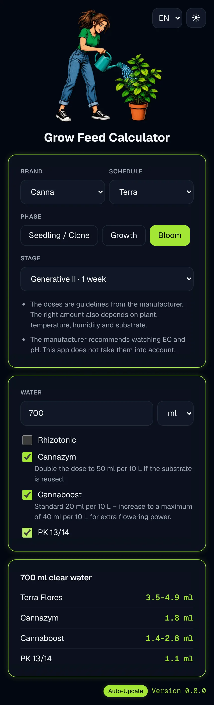
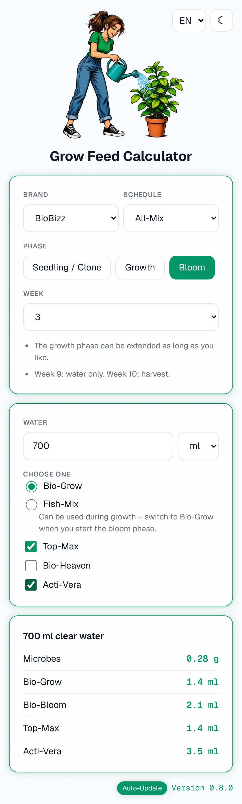
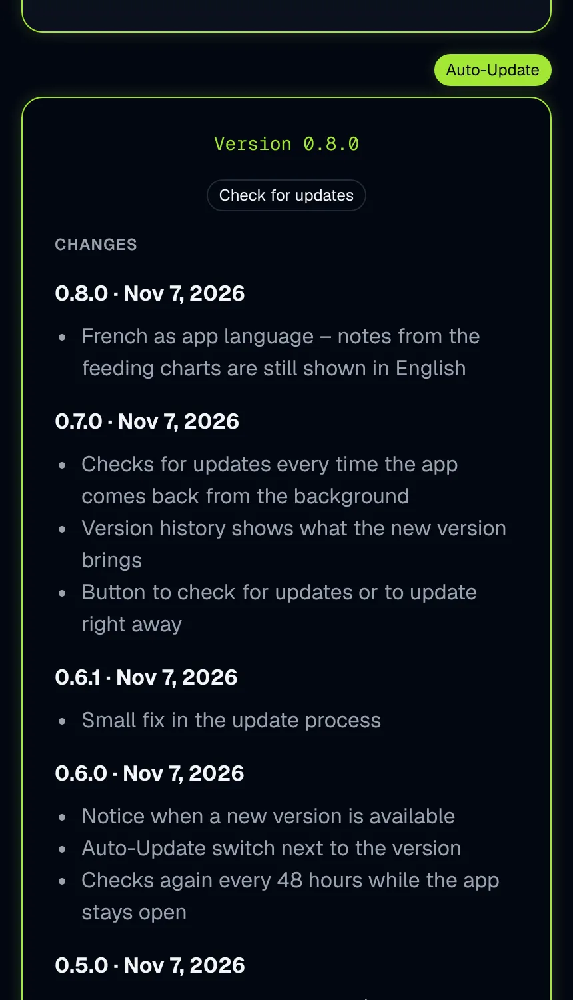

[English](/README.md) | **Deutsch**

<div align="center">


# 🌱 Dünger-Rechner

**Ein kleiner, offener Rechner für Düngermengen – direkt auf dem Handy.**<br>
Hersteller, Schema und Woche wählen, die Wassermenge eingeben und für jedes Produkt die genaue Menge bekommen.


&nbsp;


### 👉 [App öffnen](https://gerrys-codeatorium.github.io/grow-feed-calculator/)

</div>

---

> [!NOTE]
> **Frühe Version.** Der Rechner funktioniert und lässt sich auf dem Home-Bildschirm installieren.
> Weitere Düngeschemas folgen.

> [!IMPORTANT]
> **Neue Adresse.** Die App ist im Zuge einer Umstrukturierung umgezogen: https://gerrys-codeatorium.github.io/grow-feed-calculator/
> Wer sie von der alten Adresse (`gerry-git-ops.github.io`) installiert hat, bekommt dort keine Updates mehr. Bitte die alte App löschen und von der neuen Adresse neu installieren. Sprache und Update-Einstellung müssen dann neu gewählt werden.

Die App **rechnet nur**. Sie verfolgt oder überwacht deine Pflanzen nicht – das übernimmt später ein eigener
**Grow Manager**, der diesen Rechner über eine API nutzen kann.

## 📸 Bildschirmfotos

<div align="center">





</div>

> [!TIP]
> Die Bildschirmfotos sind **Beispielbilder**, die die ganze Seite auf einmal zeigen. Am Handy scrollst du
> durch die Seite, und je nach Gerät und Browser kann die App etwas anders aussehen.
>
> **Entwicklungs- und Testumgebung:** iPhone 16 Pro Max mit iOS 26.6.2.

## ✨ Funktionen

- 🏭 **Mehrere Hersteller und Schemas** – die App merkt sich deine letzte Auswahl
- 🧮 Genaue Mengen für jede Wassermenge, umgerechnet aus dem Düngeschema des Herstellers
- 📏 **Spannen**, wo der Hersteller sie angibt, z. B. `3,5–4,9 ml`
- 💧 Wasser in **ml oder L**, mit Komma oder Punkt (`700`, `0,7` oder `0.7`)
- 🧴 Produkte mit eigener Einheit – ml, Tropfen oder Gramm, pro 1 L, 4,5 L oder 10 L
- ☑️ **Optionale Produkte** nur, wenn du sie einschaltest – und nur in den Wochen, in denen sie vorkommen
- 🔀 **Entweder-oder-Produkte** – du wählst eins von mehreren Produkten, die sich gegenseitig ersetzen
- 🫗 **Vormisch-Produkte** stehen beim Wasser statt als Dosis –
  winzige Mengen wie 0,16 Tropfen lassen sich nicht abmessen, deshalb mischst du sie vorher ins Gießwasser
- 📝 Anwendungshinweise je Produkt und je Schema, direkt aus dem Düngeschema des Herstellers
- 🌍 **Englisch, Deutsch und Französisch**, automatisch passend zum Gerät, jederzeit umschaltbar
- 🌗 **Hell- und Dunkelmodus**, folgt dem Gerät, bis du selbst umschaltest
- 🔔 **Update-Hinweis**, wenn eine neue Version da ist – oder automatische Updates, du entscheidest
- 📲 **Installierbar** auf dem Home-Bildschirm und läuft **offline**
- 🏷️ Version und Änderungsverlauf direkt in der App

## 📲 Installieren

<details>
<summary><b>iPhone / iPad (Safari)</b></summary>

1. Die [App](https://gerrys-codeatorium.github.io/grow-feed-calculator/) in Safari öffnen.
2. Auf das Teilen-Symbol tippen (Quadrat mit Pfeil).
3. **Zum Home-Bildschirm** wählen.

</details>

<details>
<summary><b>Android (Chrome)</b></summary>

1. Die [App](https://gerrys-codeatorium.github.io/grow-feed-calculator/) in Chrome öffnen.
2. Auf das Menü (⋮) tippen.
3. **Zum Startbildschirm hinzufügen** oder **App installieren** wählen.

</details>

## 🔄 Updates und Offline-Betrieb

- **Die App läuft immer aus der auf dem Gerät gespeicherten Kopie** – online wie offline.
- **Online:** Bei jedem Öffnen lädt die App nur die kleine Versionsliste (`changelog.json`) und prüft,
  ob es eine neuere Version gibt – auch jedes Mal, wenn du sie aus dem Hintergrund zurückholst.
  Bleibt sie auf dem Bildschirm offen, prüft sie alle 48 Stunden erneut.
- **Auto-Update an** (Standard): Eine neue Version wird geladen und die App startet gleich neu.
- **Auto-Update aus:** Die Version wird gelb, und ein Hinweis zeigt, was neu ist. Du wählst
  *Jetzt aktualisieren*, *Später* oder *Für diese Version nicht mehr anzeigen*. Die App-Dateien werden erst beim Aktualisieren geladen.
- **Was auf dem Gerät gespeichert wird:** die App-Dateien (etwa 0,8 MB), deine Einstellungen für
  Sprache, Hell/Dunkel und Updates und deine letzte Auswahl von Hersteller, Schema, Phase, Woche und Wasser-Einheit.
  Deine Wassermenge wird **nicht** gespeichert, und nichts wird an einen Server geschickt.

Unten rechts in der App steht die installierte Version – grün, wenn sie aktuell ist, gelb, wenn es
eine neuere gibt. Antippen zeigt, was sich geändert hat – gibt es eine neuere Version, zeigt der Verlauf
schon, was sie bringt. Der Knopf oben im Verlauf sucht nach Updates oder startet das Update direkt.
Direkt neben der Version sitzt der Schalter **Auto-Update**.

## 🏷️ Änderungsverlauf

<details>
<summary><b>0.9.0</b> · 08.11.2026</summary>

- Düngeschemas jetzt auch auf Französisch: Hinweise, Abschnitte und die französischen Produktnamen von Hesi
- Übersetzungen der Düngeschemas liegen in eigenen Dateien

</details>

<details>
<summary><b>0.8.0</b> · 07.11.2026</summary>

- Französisch als App-Sprache – Hinweise aus den Düngeschemas stehen vorerst noch auf Englisch

</details>

<details>
<summary><b>0.7.0</b> · 07.11.2026</summary>

- Prüft auf Updates, sobald die App aus dem Hintergrund zurückkommt
- Der Versionsverlauf zeigt, was die neue Version bringt
- Knopf zum Suchen nach Updates oder zum direkten Aktualisieren

</details>

<details>
<summary><b>0.6.1</b> · 07.11.2026</summary>

- Kleine Korrektur beim Aktualisieren

</details>

<details>
<summary><b>0.6.0</b> · 07.11.2026</summary>

- Hinweis, wenn eine neue Version verfügbar ist
- Auto-Update-Schalter neben der Version
- Prüft alle 48 Stunden erneut, solange die App offen bleibt

</details>

<details>
<summary><b>0.5.0</b> · 07.11.2026</summary>

- Neue Düngeschemas: BioBizz (All-Mix, Light-Mix / Coco-Mix) und Canna Terra
- Hersteller und Schema wählbar – die App merkt sich die letzte Auswahl
- Mengen-Spannen, Entweder-oder-Produkte und Hinweise je Schema
- Optionale Produkte erscheinen nur in Wochen, in denen sie vorkommen

</details>

<details>
<summary><b>0.4.0</b> · 07.11.2026</summary>

- Neues Logo und App-Icon
- App auf dem Home-Bildschirm installierbar
- Funktioniert offline

</details>

<details>
<summary><b>0.3.0</b> · 07.11.2026</summary>

- Hell- und Dunkelmodus
- Englisch und Deutsch
- Umschalter für Sprache und Design

</details>

<details>
<summary><b>0.2.0</b> · 07.11.2026</summary>

- Erste Rechner-Seite
- Wasser in ml oder L, mit Komma oder Punkt
- Optionale und vorgemischte Produkte

</details>

<details>
<summary><b>0.1.0</b> · 06.11.2026</summary>

- Hesi-Erde-Düngeschema
- Berechnung der Mengen

</details>

Derselbe Verlauf steht in der App. Er liegt in [`changelog.json`](../changelog.json).

## 🧪 Enthaltene Düngeschemas

| Hersteller | Schema | Abschnitte |
|---|---|---|
| Hesi | Erde | Sämling/Steckling, 2 Wochen Wuchs, 8 Wochen Blüte (Woche 8: mit reinem Wasser spülen) |
| BioBizz | All-Mix | Anzucht, Wuchs, 8 Wochen Blüte, Woche 9 nur Wasser |
| BioBizz | Light-Mix / Coco-Mix | Anzucht, Wuchs, 8 Wochen Blüte, Woche 9 nur Wasser |
| Canna | Terra | Start, 2 Wuchs-Abschnitte, 4 Blüte-Abschnitte – mit Mengen-Spannen |

Dein Dünger fehlt? Sag mir Bescheid in einem [Issue](https://github.com/gerrys-codeatorium/grow-feed-calculator/issues).

## ⚙️ So funktioniert es

Jede Dosis in einem Düngeschema bezieht sich auf eine Wassermenge, ihre *Bezugsmenge*:

```
Menge = Dosis × Wasser ÷ Bezugsmenge
```

Beispiel: ein Produkt mit 50 ml pro 10 L. Für 700 ml Wasser sind das 50 × 0,7 ÷ 10 = **3,5 ml**.

<details>
<summary><b>Datenformat</b> – um eigene Düngeschemas hinzuzufügen</summary>

Jeder Hersteller hat eine Datei in `data/<hersteller>.json`, aufgelistet in `data/index.json`.
Die Datendateien enthalten **nur Englisch**. Übersetzungen liegen in eigenen Dateien je Sprache
(siehe unten).

**Jede Datei beginnt mit drei Feldern**

| Feld | Bedeutung |
|---|---|
| `schema` | Art der Datei: `feed-chart`, `feed-chart-index`, `feed-chart-translation` oder `app-translation` |
| `schemaVersion` | Version dieses Dateiformats – zählt für jedes `schema` getrennt |
| `version` | Stand des Inhalts dieser einen Datei – um 1 erhöhen, sobald sich Werte oder Texte ändern |

> **IDs ändern sich nach der Veröffentlichung nie.** Übersetzungen, gespeicherte Auswahl und später
> die API verweisen darauf. Zum Umbenennen den `name` ändern, nicht die `id`.

**Index – `data/index.json`**

```json
{
  "schema": "feed-chart-index",
  "schemaVersion": 1,
  "version": 1,
  "charts": ["hesi.json", "biobizz.json", "canna.json"]
}
```

**Düngeschema – `data/<hersteller>.json`** (gekürztes Beispiel)

```json
{
  "schema": "feed-chart",
  "schemaVersion": 3,
  "version": 1,
  "brand": { "id": "example", "name": "Example" },
  "schedules": [
    {
      "id": "soil",
      "name": "Soil",
      "medium": "soil",
      "notes": [{ "id": "ec-ph", "text": "A note for the whole schedule" }],
      "products": [
        { "id": "grow-a", "name": "Grow A", "unit": "ml", "baseVolumeLiters": 10 },
        { "id": "grow-b", "name": "Grow B", "unit": "ml", "baseVolumeLiters": 1, "group": "base" },
        { "id": "grow-c", "name": "Grow C", "unit": "ml", "baseVolumeLiters": 1, "group": "base" },
        { "id": "booster", "name": "Booster", "unit": "ml", "baseVolumeLiters": 10, "optional": true,
          "note": "Short usage hint" }
      ],
      "weeks": [
        { "phase": "growth", "week": 1, "doses": { "grow-a": [30, 50], "grow-b": 2, "grow-c": 2 } },
        { "id": "bloom-1", "phase": "bloom", "week": 1, "label": "Bloom I", "duration": "2–3 weeks",
          "doses": { "booster": 20 } }
      ]
    }
  ]
}
```

**Schema**

| Feld | Bedeutung |
|---|---|
| `id`, `name` | Fester technischer Name und angezeigter Name (Englisch) |
| `medium` | Substrat, z. B. `soil` (Erde) |
| `notes` | Optionale Hinweise zum ganzen Schema, jeweils mit `id` und `text` |

**Produkte**

| Feld | Bedeutung |
|---|---|
| `id` | Fester technischer Name, genutzt vom Code, den Übersetzungen und später der API |
| `name` | Produktname (Englisch) |
| `unit` | `ml`, `drops` (Tropfen) oder `g` |
| `baseVolumeLiters` | Wassermenge, auf die sich die Dosis bezieht |
| `optional` | `true`, wenn man das Produkt pro Gießen selbst einschaltet |
| `group` | Produkte mit derselben Gruppe ersetzen sich gegenseitig – man wählt eins davon |
| `premix` | `true`, wenn das Produkt vorher ins Wasser gemischt wird (steht beim Wasser, nicht als Dosis) |
| `note` | Optionaler kurzer Anwendungshinweis (Englisch) |

**Wochen und Abschnitte**

| Feld | Bedeutung |
|---|---|
| `phase` | `start` (Sämling oder Steckling), `growth` (Wachstum) oder `bloom` (Blüte) – die angezeigten Wörter kommen aus den Sprachdateien der App |
| `week` | Nummer innerhalb der Phase |
| `id`, `label`, `duration` | Nur bei Schemas mit Abschnitten statt Wochen: feste ID, Name und Dauer (Englisch) |
| `doses` | Produkt-ID → Dosis, als Zahl oder Spanne `[min, max]`. Fehlt ein Produkt, gibt es das in dieser Woche nicht; eine leere Liste heißt nur Wasser |

**Übersetzungen – `data/i18n/<sprache>.json`**

Eine Datei je Sprache für alle Hersteller. Jeder Text wird über eine feste Kennung aus den IDs
gefunden. Nötig sind nur Texte, die sich vom Englischen unterscheiden – was fehlt, erscheint auf
Englisch.

```json
{
  "schema": "feed-chart-translation",
  "schemaVersion": 1,
  "version": 1,
  "texts": {
    "example": {
      "schedules": {
        "soil": {
          "name": "Erde",
          "weeks": { "bloom-1": { "label": "Blüte I", "duration": "2–3 Wochen" } }
        }
      },
      "notes": { "ec-ph": "Ein Hinweis zum ganzen Schema" },
      "products": { "booster": { "note": "Kurzer Anwendungshinweis" } }
    }
  }
}
```

| Kennung | Text |
|---|---|
| `<hersteller>.schedules.<schema>.name` | Name eines Schemas |
| `<hersteller>.schedules.<schema>.weeks.<woche>.label` / `.duration` | Name und Dauer eines Abschnitts |
| `<hersteller>.notes.<hinweis>` | Hinweis zum Schema – gilt für alle Schemas des Herstellers |
| `<hersteller>.products.<produkt>.name` / `.note` | Produktname und Hinweis – gilt für alle Schemas des Herstellers |

</details>

<details>
<summary><b>Lokal starten</b></summary>

Stelle den Ordner über einen lokalen Webserver bereit – öffnest du `index.html` direkt, lädt der Browser
die Datendateien nicht. Zum Beispiel:

- VS Code: Erweiterung **Live Server**, dann *Open with Live Server* auf `index.html`
- Terminal: `npx serve` und die angezeigte Adresse öffnen

</details>

<details>
<summary><b>Projektstruktur</b></summary>

```
grow-feed-calculator/
├── assets/              # Logo und App-Icons
├── css/style.css        # Design
├── data/
│   ├── i18n/            # Übersetzungen der Düngeschemas (de, fr)
│   ├── index.json       # Liste aller Hersteller-Dateien
│   └── *.json           # eine Düngeschema-Datei je Hersteller
├── fonts/geist/         # Schrift Geist
├── i18n/                # Texte je Sprache (en, de, fr)
├── src/
│   ├── app.js           # Rechner-Seite: Eingaben und Ergebnis
│   ├── calculator.js    # Berechnung der Mengen
│   ├── changelog.js     # Version und Verlauf
│   ├── i18n.js          # Sprache, Mehrzahl, Zahlen- und Datumsformat
│   ├── theme.js         # Hell / Dunkel
│   └── update.js        # Versionsprüfung und Updates
├── changelog.json       # Versionsverlauf
├── index.html           # Rechner-Seite
├── manifest.webmanifest # App für den Home-Bildschirm
└── sw.js                # Offline-Betrieb
```

</details>

## ⚠️ Hinweis

Dieses Projekt steht **in keiner Verbindung zu einem Dünger-Hersteller** und wird von keinem unterstützt
oder gesponsert. Marken- und Produktnamen werden nur genannt, um zu sagen, zu welchen Produkten die Werte
gehören. Die Werte stammen aus den öffentlichen Düngeschemas der Hersteller und sind **ohne Gewähr**.
Prüfe vor der Anwendung immer das Etikett deines Produkts.

## 📄 Lizenz

- **Code:** [GPL-3.0](../LICENSE)
- **Schrift:** [Geist](https://vercel.com/font) von Vercel, unter der [SIL Open Font License 1.1](../fonts/geist/OFL.txt)
